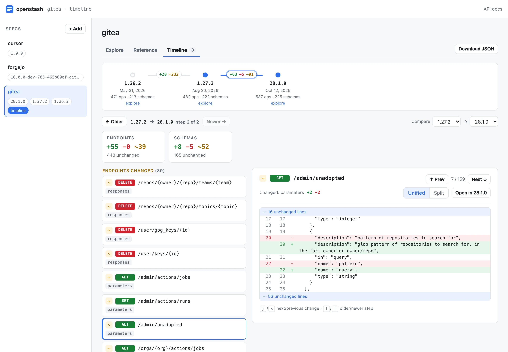

# openstash

**Keep the OpenAPI specs you work with on your machine, and look up exactly the endpoint you need, from the terminal, your coding agent, or the browser.**

<picture>
  <source media="(prefers-color-scheme: dark)" srcset="docs/images/ui-timeline-dark.webp">
  
</picture>

## Why openstash

- **Your agent finds the right endpoint.** Instead of reading a whole spec, it searches and pulls one operation. On gitea's 820 KB spec that's about 870 tokens instead of 148,000. In our benchmark, a 14B model picked the right endpoint every time with openstash and never from the raw spec. [See the benchmarks →](bench/README.md)
- **See how an API changed.** Store each version you care about, then step through what was added, removed or changed between them.
- **Local and fast.** Specs are fetched once and indexed on your machine. Refer to any of them as `key@version`, the same way every session.

## Install

```bash
brew tap MiguelAPerez/tap
brew install openstash
```

Or use a [pre-built binary](docs/install.md#pre-built-binary) or the [Docker image](docs/install.md#docker).

## Quick start

Add a spec. Any OpenAPI or Swagger file works, from a URL or a local path:

```bash
openstash add petstore --from https://petstore3.swagger.io/api/v3/openapi.json
```

Find an endpoint, then get everything you need to call it:

```bash
openstash search petstore "find pets by status"
openstash show petstore --method GET --path /pet/findByStatus --expand
```

Or browse it all in the web UI:

```bash
openstash serve      # then open http://127.0.0.1:8080
```

## Use it with your coding agent

Every command prints JSON, so agents can run openstash directly. Add something like this to your project's `AGENTS.md` or `CLAUDE.md`:

```markdown
Before calling an HTTP API, look it up with openstash instead of reading its OpenAPI file:
- `openstash explain <key>` for an overview and example commands
- `openstash search <key> "<what you need>"` to find the endpoint
- `openstash show <key> --method <METHOD> --path <path> --expand` for its parameters and body
```

Agents that can't run commands can use the [HTTP API](docs/serve-api.md) instead.

## Docs

- [Install](docs/install.md): Homebrew, binaries, Docker, building from source
- [CLI reference](docs/cli.md): every command, `key@version`, where specs are stored
- [Web UI](docs/web-ui.md): Explore, Reference and the version timeline
- [HTTP API](docs/serve-api.md): run openstash as a server for tools and agents
- [Benchmarks](bench/README.md): token cost and accuracy compared with raw specs
- [Contributing](CONTRIBUTING.md)
