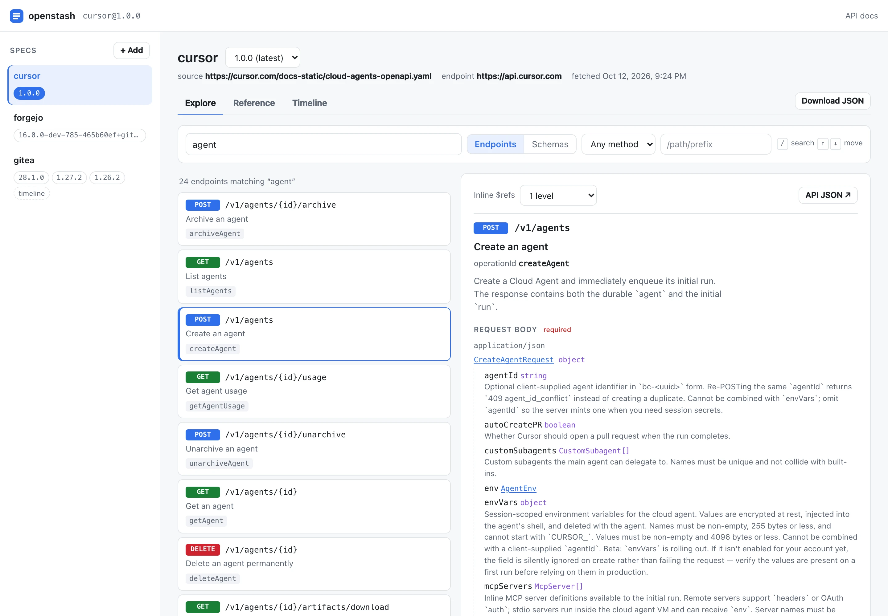

# Web UI

`openstash serve` includes a browser UI for everything in your store:

```bash
openstash serve      # then open http://127.0.0.1:8080
```

Pick a spec in the sidebar, then switch between its three views.

## Explore

Search a spec's endpoints or schemas, filter by method or path prefix, and open one operation to see its parameters, request body and responses. Choose how many levels of `$ref`s to inline.

<picture>
  <source media="(prefers-color-scheme: dark)" srcset="images/ui-explore-dark.webp">
  
</picture>

Keyboard: <kbd>/</kbd> focuses the search box, <kbd>↑</kbd>/<kbd>↓</kbd> move through the results.

## Reference

A docs-style view of one version: an overview with its servers, operations grouped by tag, and every model (schema). Filter the sidebar to jump to an operation or model.

## Timeline

Every stored version of a spec, oldest to newest, with how many endpoints and schemas were added, removed or changed at each step. Pick a step to walk through each change as a line diff, unified or side by side. Or compare any two versions directly.

<picture>
  <source media="(prefers-color-scheme: dark)" srcset="images/ui-timeline-dark.webp">
  
</picture>

Changes count when an operation's parameters, request body, responses, security or deprecation differ, including changes that only happened in a shared definition it references. Changes that only touch `x-*` vendor extensions (generator metadata, for example) are listed separately, after the real ones.

Keyboard: <kbd>j</kbd>/<kbd>k</kbd> next and previous change, <kbd>[</kbd>/<kbd>]</kbd> older and newer step.

To grow a timeline, add another version under the same key, from the CLI or with **+ Add** in the UI:

```bash
openstash add gitea --from https://gitea.example/swagger.v1.json --version 1.23.0
```

## Options

- `--addr` sets the listen address (default `127.0.0.1:8080`).
- `--no-ui` serves the [HTTP API](serve-api.md) only.
- The UI and API are on the same server, so everything in the UI is also available as JSON. See [HTTP API](serve-api.md).
- Running it somewhere other than your own machine? Read the [security notes](serve-api.md#security-notes) first: there's no authentication.
